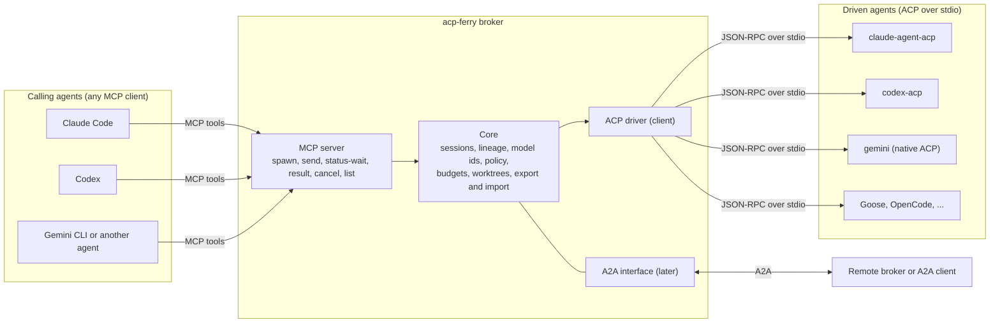
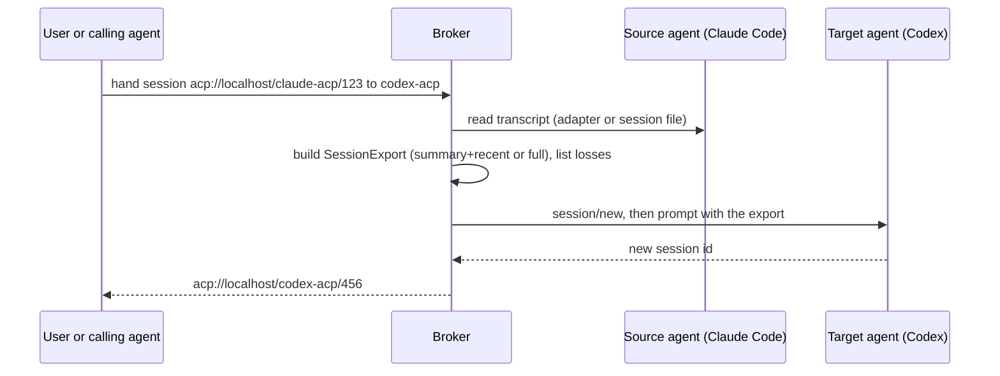

# Architecture

Audience: contributors and agents implementing the broker or reviewing the extension. This is the
target design. Sections marked "proposed" are not decided yet; the decision that settles one
updates this page. Nothing below is implemented except `packages/spec`.

Terms: the _broker_ is the local process that owns sessions. A _calling agent_ asks the broker to
do something. A _driven agent_ runs the work. An _adapter_ makes an agent speak ACP when it does not
natively.

## Packages

| Package             | Contents                                                                             | Runtime        | Status      |
| ------------------- | ------------------------------------------------------------------------------------ | -------------- | ----------- |
| `@acp-ferry/spec`   | Draft types (`types.ts`), identifier parsers (`identifiers.ts`). Later: JSON Schemas | Any JS runtime | Draft       |
| `@acp-ferry/broker` | Broker core, ACP driver, MCP server, session export and import, routing              | Node           | Placeholder |
| `@acp-ferry/cli`    | The `acp-ferry` command (R-DX-2)                                                     | Node           | Planned     |

`packages/broker` exists today with one exported constant, so the build, test, coverage and package
checks run on both packages from the start. Whether the MCP server and the CLI become separate
packages is decided when M2 starts.

## Broker

The broker speaks a different standard on each side and keeps what no standard defines in the draft
extension:

- **Driving agents: ACP.** The broker is an ACP client. It spawns each agent process and keeps its
  session handles. Model choice uses the `category: "model"` config option. Cancel, resume, list and
  usage come from the ACP session lifecycle.
- **Serving agents: MCP.** Every coding agent is an MCP client, so the broker serves a small set of
  tools that any agent can call without vendor changes. Long-running work returns a handle at once
  and the caller waits or polls.
- **Networked use: A2A (later).** An Agent Card lists the agents and models the broker hosts. An
  ACP session maps to an A2A task.

## Adapters

| Agent       | How the broker reaches it                                                   | Notes                                        |
| ----------- | --------------------------------------------------------------------------- | -------------------------------------------- |
| Claude Code | [claude-agent-acp](https://github.com/agentclientprotocol/claude-agent-acp) | Community adapter over the Claude Agent SDK  |
| Codex       | [codex-acp](https://github.com/agentclientprotocol/codex-acp)               | Community adapter                            |
| Gemini CLI  | Native ACP mode                                                             | Flag name differs between versions; check it |
| Others      | Native ACP (Goose, OpenCode, Qwen Code and others in the ACP Registry)      | Same path as Gemini                          |

The broker codes against an `AgentAdapter` interface, not against a vendor. A vendor's own richer
interface may replace an ACP adapter where it adds something, but never becomes the contract.

## Protocol mapping

| Concept                  | Calling side (MCP)           | Agent side (ACP)                                | Network (A2A, later)         | Broker-owned                   |
| ------------------------ | ---------------------------- | ----------------------------------------------- | ---------------------------- | ------------------------------ |
| Start a session          | `spawn` tool, returns handle | `session/new`                                   | Send message creates a task  | Worktree, lineage, depth check |
| Choose a model           | Tool argument (`ModelId`)    | `session/set_config_option` (`category: model`) | Extension or metadata        | `provider/model` mapping       |
| Follow-up or message     | `send` tool                  | `session/prompt`                                | Send message with task id    | Queueing, message log          |
| Stream or wait           | `status-wait` tool           | `session/update` notifications                  | Streaming, subscribe to task | Event log                      |
| Permission request       | Escalated to the caller      | `session/request_permission`                    | Input required               | Policy, narrowing (R-SEC)      |
| Cancel                   | `cancel` tool                | `session/cancel`                                | Cancel task                  | Worktree cleanup               |
| List agents and sessions | `list` tool                  | ACP Registry, `session/list`                    | Agent Card, list tasks       | Unified registry               |
| Result                   | `result` tool                | Stop reason and final message                   | Task artifacts               | `DelegationResult`             |
| Usage and limits         | Part of the result           | `usage_update`                                  | Metadata                     | `Budget`, `LimitEvent`         |
| Move a session           | `spawn` with an export       | Proposed `session/export`, `session/import`     | Not mapped                   | `SessionExport`                |

## Session portability flow (proposed)

Moving back appends only the turns added in the target, after checking that the source history is
an exact prefix (R-PORT-6).

## Extension points

| Extension             | How                                                                                  |
| --------------------- | ------------------------------------------------------------------------------------ |
| New agent             | An `AgentAdapter` for it; native ACP agents need only a registry id and a command    |
| New transcript format | A reader and a writer that map the agent's session store to and from `SessionExport` |
| New limit event       | A new member of the `LimitEvent` union, then its mapping in each adapter             |
| New routing trigger   | Follows from a new `LimitEvent` kind (`RoutingPolicy.switchOn` uses the same kinds)  |
| New front door        | Another server (CLI, A2A) on the same broker core                                    |
